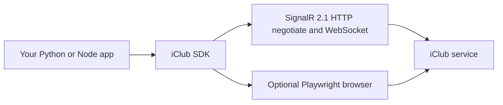

# Architecture and underlying requests

## How it works

- **Direct SignalR** powers client discovery, authentication, profile/statistics, memberships, visit/sales transactions, and reservation calendar retrieval.
- **Browser automation** is a fallback for live QR, self-registration, booking UI and credit top-up preparation; it requires Chromium.
- **No local hosted REST server** is included. Use the SDK in your own backend if you need HTTP endpoints.

## Observed hubs and methods

| Hub | Methods observed in ModernFITCLUB |
|---|---|
| `settingworkflowhub` | `GetClients`, `GetHomePageText` |
| `authenticationworkflowhub` | `Login`, `Logout`, `ChangePassword` |
| `personworkflowhub` | `GetUser`, `GetCustomerStats`, `SubmitUser` |
| `ticketworkflowhub` | `GetCustomerAvailableTickets` |
| `transactionworkflowhub` | `GetVisitsTransactions`, `GetSalesTransactions`, `GetTransaction` |
| `reservationworkflowhub` | `GetCustomerEvents`, `GetRooms`, `GetRoomsEvents` |

The Python transport negotiates via HTTPS `/signalr/negotiate`, connects to WebSocket `/signalr/connect` and calls `/signalr/start`. It correlates calls by SignalR invocation ID. The Node transport uses the source app's equivalent SignalR client. Endpoint base: `https://online.iclub.sk`.

## Authentication

Club discovery resolves the selected gym to an `Ident`. The SDK obtains a new `SessionId`/GUID and calls `authenticationworkflowhub.Login` with an email and SHA-256/Base64-encoded password. **Hashing here is a protocol requirement, not password encryption at rest**. HTTPS/WSS protect transport. Session state is kept in process memory.

## Direct calls vs browser

| Feature | Mechanism | Can run without Chromium? |
|---|---|---|
| List gyms, login, user, stats, credit | SignalR | Yes |
| Visits, transaction history, event calendar | SignalR | Yes |
| Contact update / password change | SignalR | Yes |
| QR image | Playwright | No |
| Reserve class | Calendar validation + Playwright UI | No |
| Register account | Playwright UI | No |
| Prepare top-up | Playwright UI | No |

The app's existing SignalR methods are not evidence that a stable official API exists. They are private implementation details, and testing across clubs is necessary.

## Read caches

Some composite operations cache responses briefly: dashboard ~10 seconds, profile ~15 seconds, visits ~10 seconds, calendar ~15 seconds, visit details ~60 seconds. Values are stale until cache expiration or reset. Python exposes `clear_cache()`; write operations internally clear relevant caches in the current implementation. Do not use cached states as definitive booking/payment confirmation.

## Error boundaries

Transport failures and rejected hub state are surfaced as exceptions. Browser flows can fail if the page layout or locale changes. Never retry a write request blindly after a timeout, because the remote action may already have happened.
